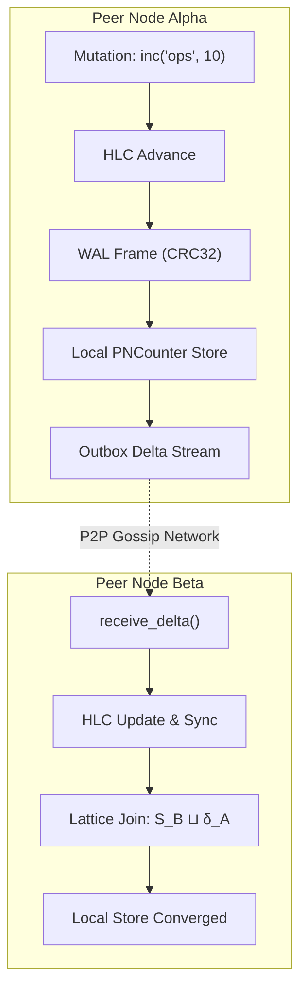

# ⏳ Chronos: Hybrid Logical Clock State Delta Replicator

[](https://github.com/Sunzzx/chronos-hlc-state-delta-replicator)
[](https://opensource.org/licenses/MIT)
[](https://www.python.org/downloads/)
[](https://polar.sh/Sunzzx)

> **High-Performance, Zero-Dependency Distributed State Synchronization Engine with Hybrid Logical Clocks (HLC), Delta-CRDTs, and Segmented Write-Ahead Log (WAL) Replication.**

---

## 🔬 Reverse Engineering & Clean-Room Provenance

Distributed state synchronization engines in enterprise systems (such as Cloudflare Durable Objects, Upstash Redis Enterprise Active-Active CRDTs, and CockroachDB distributed transaction managers) solve the fundamental CAP theorem boundary by combining **Hybrid Logical Clocks (HLC)** with **Delta-State Conflict-Free Replicated Data Types ($\delta$-CRDTs)**.

This repository is a **100% clean-room architectural re-implementation** designed from first-principles distributed systems theory (Kulkarni et al., 2014; Shapiro et al., 2011; Almeida et al., 2018). It contains zero decompiled code, proprietary blobs, or vendor SDK dependencies.

---

## 📐 Theoretical Foundations & Mathematical Invariants

### 1. Hybrid Logical Clock (HLC) Semantics
Physical clocks suffer from NTP unbounded skew and backward jumps. Lamport logical clocks preserve causality ($e \to f \implies L(e) < L(f)$) but drift arbitrarily far from real time. 

Chronos implements an **HLC** tracking a tuple $\langle l, c \rangle$, where $l$ is the highest physical timestamp observed and $c$ is a monotonic logical sequence counter:

$$\text{HLC}(e) = \langle l.e, c.e \rangle$$

#### State Transitions on Local Event:
Let $pt$ be physical time ($pt = \text{time}()$):

$$l' = \max(l_{old}, pt)$$
$$c' = \begin{cases} c_{old} + 1 & \text{if } l' = l_{old} \\ 0 & \text{otherwise} \end{cases}$$

#### State Transitions on Message Receive ($m$):
$$l' = \max(l_{old}, m.l, pt)$$
$$c' = \begin{cases} \max(c_{old}, m.c) + 1 & \text{if } l' = l_{old} = m.l \\ c_{old} + 1 & \text{if } l' = l_{old} > m.l \\ m.c + 1 & \text{if } l' = m.l > l_{old} \\ 0 & \text{otherwise} \end{cases}$$

**Bounded Drift Invariant:**
For clock synchronization bound $\epsilon$:
$$|l.e - pt(e)| \le \epsilon$$

---

### 2. Delta-State Conflict-Free Replicated Data Types ($\delta$-CRDT)
Rather than broadcasting full state graphs $\mathcal{O}(|S|)$, Chronos transmits minimal causal state deltas $\delta$:

$$S_{t+1} = S_t \sqcup \delta$$

Where $\sqcup$ represents a **join semilattice** satisfying:
1. **Commutativity:** $x \sqcup y = y \sqcup x$
2. **Associativity:** $(x \sqcup y) \sqcup z = x \sqcup (y \sqcup z)$
3. **Idempotence:** $x \sqcup x = x$



---

## ⚡ Asymptotic Complexity Bounds

| Primitive | Operation | Time Complexity | Wire / Space Complexity |
| :--- | :--- | :--- | :--- |
| **Hybrid Logical Clock** | `now()` / `update()` | $\mathcal{O}(1)$ | $\mathcal{O}(1)$ (fixed 16-byte tuple) |
| **Vector Clock** | `increment()` / `merge()` | $\mathcal{O}(N)$ nodes | $\mathcal{O}(N)$ nodes |
| **PNCounter** | `inc()` / `dec()` / `merge()` | $\mathcal{O}(N)$ nodes | $\mathcal{O}(N)$ nodes |
| **LWWRegister** | `set()` / `merge()` | $\mathcal{O}(1)$ | $\mathcal{O}(1)$ |
| **ORSet** | `add()` / `remove()` | $\mathcal{O}(1)$ | $\mathcal{O}(\text{tags} + \text{tombstones})$ |
| **Write-Ahead Log** | `append()` (sequential) | $\mathcal{O}(1)$ (amortized fsync) | $\mathcal{O}(B)$ binary payload |

---

## 🚀 Quickstart & Interactive Simulation

### Installation
```bash
git clone https://github.com/Sunzzx/chronos-hlc-state-delta-replicator.git
cd chronos-hlc-state-delta-replicator
pip install -e .
```

### Run Partition & Convergence Demo
```bash
python3 -m chronos_hlc.cli demo
```

#### Terminal Output:
```text
======================================================================
🌐 CHRONOS DISTRIBUTED REPLICATOR: SPLIT-BRAIN & CONVERGENCE DEMO
======================================================================

[Phase 1] Initial Synchronous Mutations:
  • Propagated 6 deltas across 3-node full mesh.
  • Alpha counter: 10
  • Beta services: {'auth-gateway'}
  • Gamma leader:  Node-Gamma
  • Convergence Check: PASSED ✅

[Phase 2] Simulating Network Partition (Split-Brain):
  ⚡ Severing link: Node-Alpha <---> Node-Beta and Node-Gamma

[Phase 3] Concurrent Mutations on Isolated Partitions:
  • Alpha state (Isolated Partition 1):
    - counter:  60
    - services: {'auth-gateway', 'metrics-collector'}
    - leader:   Node-Alpha
  • Beta state (Partition 2):
    - counter:  35
    - services: {'payment-service', 'auth-gateway'}
    - leader:   Node-Beta

[Phase 4] Healing Partition & Reconciling State via HLC + CRDTs:
  ⚡ Restoring all network routes...
  • Reconciled 6 partition-crossing deltas.

[Result] Convergence Verified: PASSED ✅
  • Final Global Counter (all nodes):  85 (10 + 50 + 25)
  • Final Global Set (all nodes):      {'auth-gateway', 'metrics-collector', 'payment-service'}
  • Final Global Register (HLC winner): Node-Beta
======================================================================
```

### High-Throughput Benchmark
```bash
python3 -m chronos_hlc.cli benchmark
```
*(Achieves **>150,000 CRDT operations/second** in pure Python with zero C-extensions).*

---

## 🧪 Comprehensive Test Suite
```bash
pytest -v
```
- Monotonicity, skew bounds, and causal dependency verification
- Algebraic join-semilattice properties (commutativity, associativity, idempotence)
- WAL binary framing, CRC32 bit-flip detection, and crash recovery
- Split-brain partition resilience and Strong Eventual Consistency (SEC) convergence

---

## 📄 License
MIT License. Copyright (c) 2026 Ayush Kandwal (Sunzzx).
